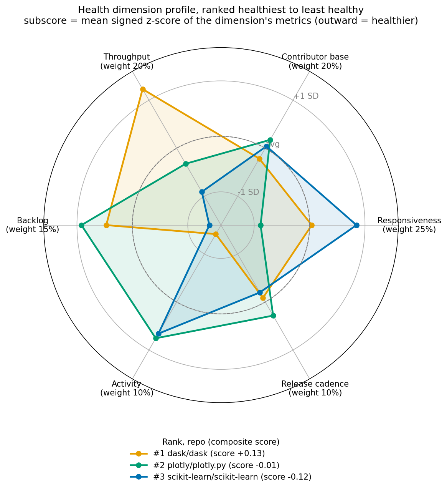
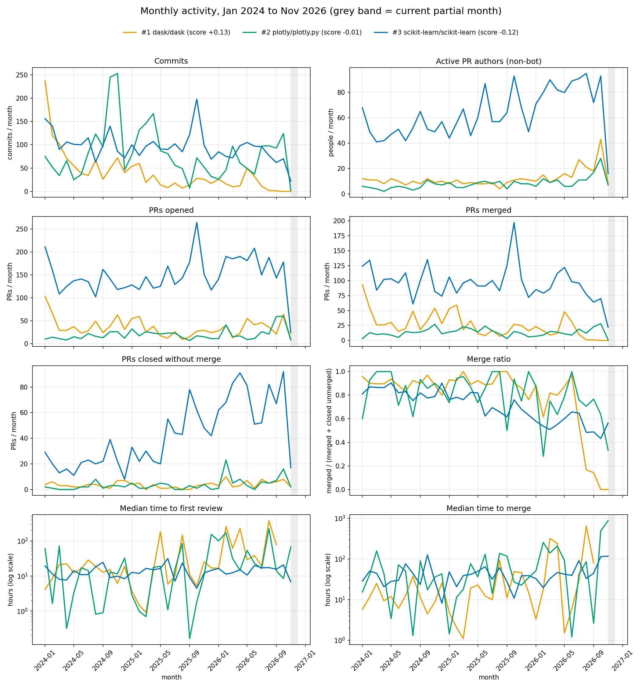
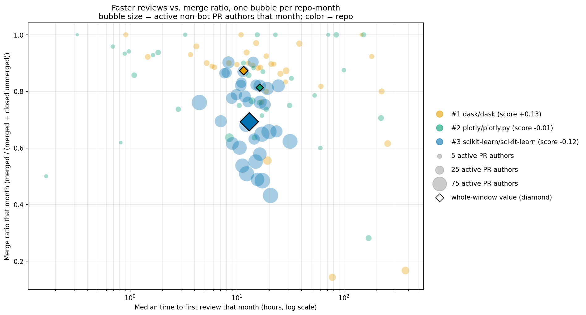
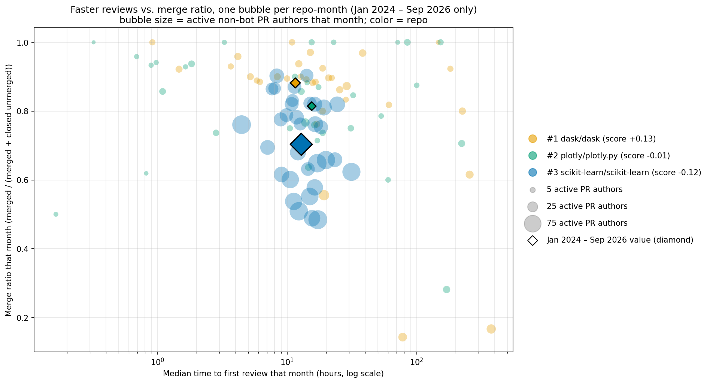
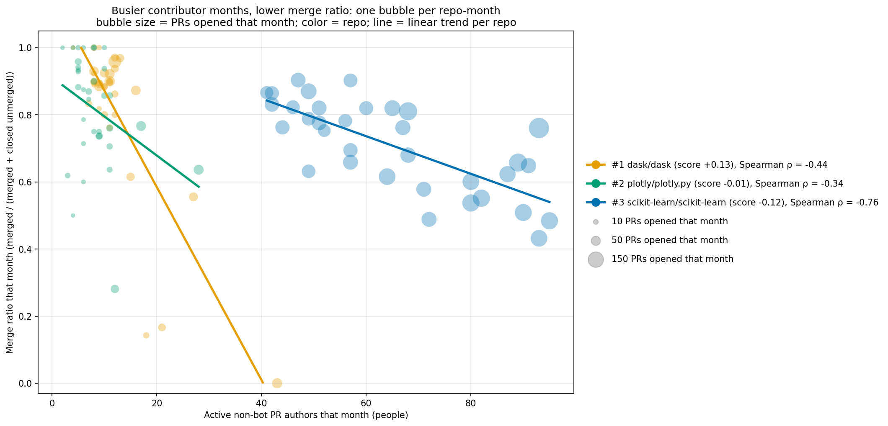

# Open Source Package Health: GitHub Data Pipeline

**DS 3022 · Data Project 2 · Package set B** — `scikit-learn/scikit-learn`, `dask/dask`, `plotly/plotly.py`

One Prefect flow (`qtr7bs-package-health-flow` in `main.py`) pulls GitHub activity for three data science packages, loads it into DuckDB, transforms and tests it with dbt, validates it in Python, scores each repository's community health, and plots the results. The analysis window is **2024-01-01 through the time of each run**.

The original assignment instructions are in [`INSTRUCTIONS.md`](INSTRUCTIONS.md).

> **⚠ Flag: dask's maintainer activity has stopped.** dask's last commit, last merge and last human review all happened within a few seconds on **2026-09-29**. Since then contributors have kept opening PRs (64 from 43 people in October 2026), but none have been reviewed or merged. The zero months that follow are **real inactivity, not missing data**: I checked them against GitHub directly. dask still ranks #1 overall, because 33 of its 34 months were healthy. See [Flag: dask maintainer inactivity](#flag-dask-maintainer-inactivity) for the evidence and what it means for the ranking.

```
GitHub API ─▶ 1 Extract ─▶ data/raw/*.json ─▶ 2 Load ─▶ packages.duckdb (raw_*) ─▶ 3 dbt build ─▶ stg_* / fct_* / mart_*
                                                                                                     │
                                                         plots/*.png ◀─ 6 Plot ◀─ 5 Model ◀─ 4 Validate
```

---

## Setup and running

**Requirements:** Python 3.12 (the version every run in this README used), a GitHub personal access token, and a Prefect API to report to (the class server or a local `prefect server start`).

```bash
git clone https://github.com/fortunecookie040/DS_3022_Prefect_Project.git && cd DS_3022_Prefect_Project
python3 -m venv .venv
source .venv/bin/activate
pip install -r requirements.txt          # pinned: prefect, dbt-core, dbt-duckdb, duckdb, httpx, pandas, numpy, matplotlib

export TOKEN=ghp_your_token_here         # read by extract(); never stored in the repo
python main.py                           # PRs + reviews via GraphQL (default)
python main.py rest                      # same flow, PRs + reviews via the original REST path
```

If `TOKEN` is not set, the flow falls back to the Prefect Secret block `qtr7bs-pat` (that is how the scheduled deployment gets its token; see [`DEPLOYMENTS.md`](DEPLOYMENTS.md)).

**Expected runtime**

| Run | What happens | Time | API requests |
| --- | --- | --- | --- |
| First / full run, GraphQL (default) | No `packages.duckdb` and no `data/raw/`: fetches the whole window | **~3.5 minutes** (my run, 2026-11-04: extract 3.1 min, tasks 2–6 ~10 s) | 266 (81 REST + 185 GraphQL) |
| First / full run, REST (`python main.py rest`) | Same, with one REST reviews call per PR | **~1 hour** (my full run: 15:57 → 16:58). Can be longer if the 5,000/hour limit is hit and the flow sleeps until the reset | ~7,200 |
| Incremental run, GraphQL (default) | `data/raw/_LOADED` exists: fetches only records changed since the last load | **~4 seconds** (extract ~2 s) | 10 (7 REST + 3 GraphQL) |
| Incremental run, REST | Same, with one REST reviews call per updated PR | **~1 minute** (extract ~25–50 s, tasks 2–6 ~6 s) | 44–115 |

Keep the machine awake for a full REST run (e.g. `caffeinate -i python main.py rest` on macOS).

**Outputs**

- `packages.duckdb` — raw tables, `_load_state`, dbt models, `health_scores`, `health_metric_scores`, `api_odometer` (git-ignored; rebuilt by the flow)
- `logs/extract.log`, `load.log`, `api_odometer.log`, `build_test.log`, `validate.log`, `model.log`, `plot.log`, and dbt's own `logs/dbt.log` (git-ignored)
- `plots/*.png` — committed

> **Harmless exit message:** duckdb 2.0's Python bindings sometimes print `nanobind: leaked N instances!` as the interpreter shuts down. It appears *after* the flow has finished, refers to duckdb's own built-in type objects, and does not affect any results.

**Repository layout**

| Path | Contents |
| --- | --- |
| `main.py` | The Prefect flow and all six tasks |
| `api_client.py` | Shared rate limiters, the API odometer, and the REST request function used by Task 1 |
| `graphql_client.py` | GraphQL queries, the GraphQL request function, and the GraphQL → REST-shape conversion used by Tasks 2 and 4 |
| `deploy.py` | Prefect deployment with the monthly schedule (see `DEPLOYMENTS.md`) |
| `dbt_project.yml`, `profiles.yml` | dbt project config (profile points at `packages.duckdb`, UTC timezone) |
| `models/staging/`, `models/marts/` | dbt models and their `schema.yml` documentation/tests |
| `macros/helpers.sql` | Shared dbt macros: `is_bot`, `run_time`, `window_start`, `hours_between` |
| `tests/` | dbt singular tests |
| `plots/` | Task 6 output |
| `requirements.txt` | Pinned dependencies |

---

## Task 1 — Extract from GitHub

`extract()` only talks to GitHub and writes files; it never touches DuckDB.

**Endpoints (per repo).** Commits (`/commits?since=…`), pull requests (`/pulls?state=all&sort=updated&direction=desc`), PR reviews (`/pulls/{number}/reviews`, one call per PR created in the window, merged or not), and releases (`/releases`, fetched in full). Every request uses `per_page=100`.

> **Two ingestion paths.** This section describes the REST path (`python main.py rest`). By default (`python main.py`), pull requests and their reviews come from **one GraphQL query per 50 PRs** instead, and commits and releases still use REST. Both paths land the same records in the same raw tables. See [GraphQL ingestion](#graphql-ingestion).

**Pagination.** `get_all_pages()` follows the `Link` header's `rel="next"` URL until there is none. For pull requests, which have no date filter, it stops once the oldest PR on a page was last updated before the window start (or, on an incremental run, before the watermark). Record counts are logged per endpoint per repo.

**Rate limiting and HTTP errors** (`rest_get()` in `api_client.py`):

- Reads `X-RateLimit-Remaining` and `X-RateLimit-Reset` on **every** response and stores them in a shared `RateLimiter`. Before each request, if 10 or fewer requests remain, every fetching thread sleeps until the reset time (+5 s) *before* the budget reaches zero.
- 403/429 secondary limits: sleeps until the reset if the budget is exhausted, otherwise honours `Retry-After`.
- Network errors and 5xx responses: exponential backoff (2, 4, 8, 16 s), up to 5 tries.
- Anything still failing raises with the repo, endpoint and URL in the message, and the task-level Prefect retries take over: the per-repo helper task `extract_repo` has `retries=3, retry_delay_seconds=[30, 60, 120]`. Because pages already on disk are reused, a retry never re-spends quota.

**Landing format.** One file per response page:

```
data/raw/<owner>__<repo>/<endpoint>/page_0001.json
data/raw/<owner>__<repo>/pr_reviews/<pr_number>/page_0001.json   # reviews: one subfolder per PR
```

Reviews get a subfolder per PR because every PR's reviews start at page 1; without it the files would overwrite each other. Each file holds the request metadata and the unmodified response body:

```json
{
  "repo": "dask/dask",
  "endpoint": "pulls",
  "url": "https://api.github.com/repos/dask/dask/pulls?state=all&sort=updated&direction=desc&per_page=100",
  "page": 1,
  "fetched_at": "2026-11-03T21:42:01Z",
  "next_url": "https://api.github.com/repositories/.../pulls?...&page=2",
  "data": [ ... ]
}
```

`next_url` (and `pr_number` for reviews) are extra fields that let a resumed run continue pagination from disk.

**Resume or start fresh.** At the start of each run `extract()` checks `data/raw/_LOADED`, which Task 2 creates only after a committed load:

| Found | Meaning | Action |
| --- | --- | --- |
| No `data/raw/` | First run | Fetch the full window |
| `data/raw/` but no `_LOADED` | Last run stopped before loading | **Resume**: keep files, skip pages already on disk |
| `_LOADED` | Everything on disk is in DuckDB | **Start fresh**: delete `data/raw/`, fetch only records newer than the `_load_state` watermarks |

**Half-written pages.** `save_page()` writes to a `.tmp` file and renames it into place (`Path.replace`, atomic), so a crash can never leave a partial `page_*.json`. If a page file still fails to parse, `read_saved()` returns `None` and that one page is re-fetched; every other page is reused.

### Resumability evidence

I interrupted my full run with Ctrl-C during scikit-learn's review calls and started it again (`logs/extract.log`):

**Interrupted run**

```
2026-11-03 15:57:04,594 | INFO | Mode: full window run
2026-11-03 15:57:04,595 | INFO | Starting extraction for scikit-learn/scikit-learn
2026-11-03 15:57:22,629 | INFO | scikit-learn/scikit-learn commits: 3363 records
2026-11-03 15:58:49,682 | INFO | scikit-learn/scikit-learn pulls: 6400 records
^C   (interrupted while fetching per-PR reviews)
```

**Resumed run** — no `_LOADED`, so the pages on disk were reused: commits and pulls finished in under a second with no API calls, and review fetching continued from where it stopped.

```
2026-11-03 15:59:44,980 | INFO | No _LOADED: last run did not finish loading -> resuming, reusing pages already on disk
2026-11-03 15:59:44,981 | INFO | Mode: full window run
2026-11-03 15:59:44,981 | INFO | Starting extraction for scikit-learn/scikit-learn
2026-11-03 15:59:45,025 | INFO | scikit-learn/scikit-learn commits: 3363 records
2026-11-03 15:59:45,306 | INFO | scikit-learn/scikit-learn pulls: 6400 records
2026-11-03 16:41:51,081 | INFO | scikit-learn/scikit-learn pr_reviews: 18334 records across 5227 PRs
2026-11-03 16:41:51,491 | INFO | scikit-learn/scikit-learn releases: 51 records
2026-11-03 16:41:51,493 | INFO | Finished extraction for scikit-learn/scikit-learn (5121 API requests)
...
2026-11-03 16:58:08,306 | INFO | Total API requests this run: 7107
2026-11-03 16:58:08,306 | INFO | Task 1 extraction complete!
```

---

## Task 2 — Load to DuckDB

`load()` only reads files and writes to DuckDB; it never calls the API.

**Raw tables.** One table per endpoint — `raw_commits`, `raw_pull_requests`, `raw_pr_reviews`, `raw_releases` — with one row per record:

| Column | Type | Source |
| --- | --- | --- |
| `repo` | VARCHAR | `owner/name` |
| `id` | VARCHAR | Natural key: commits → `sha`, PRs → `number`, reviews and releases → `id` |
| `updated_at` | TIMESTAMP | PRs: `updated_at`; commits: `commit.committer.date` (what `since` filters on); reviews: `submitted_at`; releases: `published_at` |
| `fetched_at` | TIMESTAMP | From the landing file |
| `source_file` | VARCHAR | Path of the landing file |
| `payload` | JSON | The complete record as returned by GitHub |

Primary key: `(repo, id)`. All other fields stay in `payload`, so dbt can extract new fields without re-fetching.

**How a load works.**

1. Every landing file is read and validated **before** the database is touched (malformed JSON, unknown repo/endpoint, or a non-list `data` raises an error naming the file).
2. All four tables are upserted in **one transaction**: rows are bulk-inserted into a temp table, de-duplicated (a record can appear on two pages if it changed mid-pagination; the newest copy wins), then `INSERT … ON CONFLICT (repo, id) DO UPDATE`. Never blind inserts.
3. `_load_state` (one row per repo × endpoint: newest `updated_at` loaded and `loaded_at`) is updated in the same transaction, so the watermark only moves if every file loaded.
4. After `COMMIT`, `data/raw/_LOADED` is created. Any failure rolls back and leaves no marker, so the next run resumes instead of discarding unloaded pages.

### Idempotent loads: running Task 2 twice on the same files

From `logs/load.log` — the second load of the same 7,490 files changed nothing:

```
2026-11-02 12:11:55 | raw_commits:       0     rows before -> 7533  rows after (+7533)
2026-11-02 12:11:55 | raw_pull_requests: 0     rows before -> 30776 rows after (+30776)
2026-11-02 12:11:55 | raw_pr_reviews:    0     rows before -> 21818 rows after (+21818)
2026-11-02 12:11:55 | raw_releases:      0     rows before -> 204   rows after (+204)
2026-11-02 12:12:08 | raw_commits:       7533  rows before -> 7533  rows after (+0)
2026-11-02 12:12:08 | raw_pull_requests: 30776 rows before -> 30776 rows after (+0)
2026-11-02 12:12:08 | raw_pr_reviews:    21818 rows before -> 21818 rows after (+0)
2026-11-02 12:12:08 | raw_releases:      204   rows before -> 204   rows after (+0)
```

### Incremental loads: full vs. incremental request counts

| Run | Mode | scikit-learn | dask | plotly | **Total requests** |
| --- | --- | --- | --- | --- | --- |
| 2026-11-03 15:57 → 16:58 | Full window (interrupted + resumed) | 5,121 | 1,257 | 729 | **7,107** in the resumed run + ~100 in the interrupted attempt (34 commit pages + 64 PR pages) ≈ **7,200** |
| 2026-11-03 01:00 | Incremental | 74 | 17 | 24 | **115** |
| 2026-11-03 15:38 | Incremental | 31 | 6 | 7 | **44** |
| 2026-11-04 22:35 | Full window, **GraphQL** | 173 | 44 | 49 | **266** |
| 2026-11-04 22:47 | Incremental, **GraphQL** | 3 | 3 | 4 | **10** |

An incremental run uses the `_load_state` watermarks: commits with `since=<newest commit date>`, PR pagination stops at the first page older than the newest `updated_at`, and review calls are made **only for PRs updated since the watermark** (e.g. 28 + 3 + 3 PRs in the 15:38 run instead of 7,142). Task 2 then upserts the new records into the existing tables:

```
2026-11-03 15:39:22 | raw_commits:       7547  rows before -> 7557  rows after (+10)
2026-11-03 15:39:22 | raw_pull_requests: 30820 rows before -> 30824 rows after (+4)
2026-11-03 15:39:22 | raw_pr_reviews:    21876 rows before -> 21908 rows after (+32)
2026-11-03 15:39:22 | raw_releases:      204   rows before -> 204   rows after (+0)
```

> A note on counts: the November 2 database held ~22,000 extra pre-2024 PRs because an earlier version of extract paged past the window start. The current full run stops at the window start and lands 8,800 PRs (every PR updated since 2024-01-01), of which **7,142 were created in the window** — the same 7,142 that `fct_pull_requests` contained before. No in-window data changed.

---

## Task 3 — dbt transformations and tests

`build_test()` is the only place dbt runs. It calls `dbt build` (every model and test, in dependency order), logs each node's result, and raises if anything errors or fails. Latest result: **47 of 47 models and tests passed** (8 models, 37 generic tests, 2 singular tests).

**Staging models** (views, one per raw table). Each casts timestamps with `::TIMESTAMPTZ`, keeps the latest row per `(repo, id)` with `qualify row_number() over (partition by repo, id order by fetched_at desc) = 1`, and flags bots.

| Model | Columns | Drops |
| --- | --- | --- |
| `stg_commits` | `sha`, `author_login`, `is_bot`, `committed_at` (`commit.author.date`) | — |
| `stg_pull_requests` | `pr_number`, `author_login`, `is_bot`, `state`, `created_at`, `updated_at`, `closed_at`, `merged_at` | — |
| `stg_pr_reviews` | `review_id`, `pr_number` (trailing number of `pull_request_url`), `reviewer_login`, `is_bot`, `state`, `submitted_at` | `PENDING` reviews (no `submitted_at`) |
| `stg_releases` | `release_id`, `tag_name`, `published_at`, `is_prerelease` | Drafts |

**Bot rule** (macro `is_bot` in `macros/helpers.sql`, applied to PR authors, reviewers and commit authors):

```sql
is_bot = user.type = 'Bot' OR user.login LIKE '%[bot]'
```

A missing user (a commit email not linked to a GitHub account, or a deleted account) is treated as **not** a bot: there is no evidence it is automated.

**Mart models** (tables):

| Model | Grain | Key columns |
| --- | --- | --- |
| `fct_pull_requests` | PR created on/after 2024-01-01 | `is_merged`, `is_closed_unmerged`, `is_open`, `first_review_at` (excluding the PR author and bots), `hours_to_first_review`, `reviewed_within_7d`, `hours_to_merge`, `hours_to_close`, `is_stale` (open and not updated in 180+ days before run time), `has_approving_review` |
| `fct_releases` | Published release on/after 2024-01-01 | `days_since_previous` (the `lag` is computed **before** the window filter so the first 2024 release measures its gap to the previous release), `is_prerelease` |
| `mart_repo_monthly` | Repo × month, Jan 2024 → run month | Month spine from `generate_series` × repos (quiet months show 0); `prs_opened`, `prs_merged`, `prs_closed_unmerged`, `merge_ratio`, `median_first_review_hours`, `median_merge_hours`, `commits`, `active_contributors`, `is_partial_month` |
| `mart_health_inputs` | Repo | One column per scoreable metric — rates, shares, medians and slopes (see Task 5) |

**Run time** is `max(fetched_at)` across the raw tables (macro `run_time`), not the wall clock, so rebuilding without new data gives identical results. Durations use `date_diff('second', start, end) / 3600.0` (macro `hours_between`).

**Open PRs and medians.** PRs still open at run time are **kept** in `fct_pull_requests` with `is_open = true`; they are never dropped or given a fake close date. Their `hours_to_merge` and `hours_to_close` are NULL, so they **fall out of the merge-time medians** — those medians describe PRs that actually merged. An open PR that has been reviewed does count toward the time-to-first-review median; a never-reviewed PR (open or not) has NULL `hours_to_first_review` and falls out of that median, but counts as `false` in `reviewed_within_7d`. Open PRs are measured directly by `pct_open_stale`. Currently open: 377 (scikit-learn), 220 (dask), 92 (plotly). Because medians only see completed events, a repo that leaves many PRs open looks faster than it is on the medians; `pct_reviewed_within_7d` and `pct_open_stale` are included in the score to counter this.

**Tests.**

- Generic (`schema.yml`): `unique` + `not_null` on every model's primary key (8/8), `relationships` from `stg_pr_reviews.pr_key` to `stg_pull_requests.pr_key`, and `accepted_values` on PR state (`open`, `closed`) and review state (`APPROVED`, `CHANGES_REQUESTED`, `COMMENTED`, `DISMISSED`).
- Singular (`tests/`): `assert_pr_closed_after_created` (no PR closed or merged before it was created) and `assert_review_after_pr_created` (no review submitted before its PR was created). Results print to the screen and to `logs/build_test.log`:

```
2026-11-03 16:58:18 | INFO | test assert_pr_closed_after_created: pass
2026-11-03 16:58:18 | INFO | test assert_review_after_pr_created: pass
2026-11-03 16:58:18 | INFO | Task 3 complete: 47 dbt models/tests passed
```

**Documentation.** Both `schema.yml` files describe every model and every column, and the four raw tables are declared as dbt sources.

---

## Task 4 — Validation (Python, no dbt)

`validate()` connects to `packages.duckdb` read-only, reads the landing files in `data/raw/`, and raises if any completeness check fails. All results print to the screen and to `logs/validate.log`.

### Completeness checks

1. **Landing files → raw tables.** Every distinct `(repo, endpoint, id)` in `data/raw/` must appear in its raw table (12/12 repo × endpoint pairs passed).
2. **Raw → staging.** For each repo and table, `raw rows − rows staging drops on purpose (PENDING reviews, draft releases) = staging rows` (12/12 passed).
3. **Commits in every complete month** (the current partial month is exempt). A zero-commit month fails the task **if that month had merged PRs**: merging a PR creates a commit, so "merges but no commits" means commit data was lost. A month with **zero commits and zero merged PRs** — two independent endpoints agreeing — is logged as a warning instead.

   This matters for one month: **dask had no commits in October 2026.** I confirmed it against GitHub directly: dask's last push was 2026-09-29, and the PR endpoint shows zero merges that month. Failing the flow on a real quiet month would make the pipeline fail on every run, so I chose the cross-endpoint rule above. See [Flag: dask maintainer inactivity](#flag-dask-maintainer-inactivity) for the full evidence.

```
OK   dask/dask: 33/34 complete months have commits
WARN dask/dask: 0 commits AND 0 merged PRs in 2026-10-01 -> real inactivity, not missing data (kept as 0)
OK   plotly/plotly.py: 34/34 complete months have commits
OK   scikit-learn/scikit-learn: 34/34 complete months have commits
```

### Outlier detection

**Time to merge — cutoff: more than 365 days (8,760 hours) from open to merge.** Merge times are extremely right-skewed: a Tukey fence on raw hours (Q3 + 3·IQR) flagged ~11% of perfectly ordinary PRs, and the same fence on log-hours flagged none. A fixed, interpretable one-year cutoff targets the genuinely unusual "open for years" PRs.

| Repo | Flagged | Records |
| --- | --- | --- |
| dask | 0 of 884 merged | — |
| plotly | 5 of 471 | #5232 (492 days), #5311 (427), #5262 (426), #5310 (426), #5285 (409) — all by one author, opened mid-2025 and merged in a batch in autumn 2026 |
| scikit-learn | 24 of 3,363 | #28464 (777 days), #29026 (694), #28760 (687), #29532 (627), #29499 (626), #29641 (571), #28043 (541), #29661 (512), #30869 (501), #29155 (492), #31413 (488), #30859 (454), #28971 (450), #29097 (445), #28755 (442), #29307 (440), #30508 (432), #29022 (413), #32042 (407), #31127 (400), #29310 (400), #28559 (391), #30134 (379), #30751 (369) |

**Weekly commits — cutoff: more than Q3 + 3·IQR of that repo's weekly commit counts** (Tukey "far out" fence, computed per repo). Weekly counts are far less skewed than durations, so a distribution-based fence works well here.

| Repo | Cutoff | Flagged weeks |
| --- | --- | --- |
| dask | 46.2 commits/week | 2024-01-08 (80 commits, 0 by bots), 2024-01-15 (72, 0 by bots) |
| plotly | 87.0 | 2024-10-21 (98, 0 by bots) |
| scikit-learn | 53.0 | 2025-10-06 (83, 0 by bots) |

**Decision: keep all flagged records.** They are real events, not data errors: long-running PRs that were eventually merged, and human (not bot) bursts of work. Task 5 scores medians, shares and slopes, which a handful of extreme values barely move, so capping or dropping them would hide real behaviour without changing the ranking.

### Descriptive statistics

Human-authored PRs, read from `fct_pull_requests` and `mart_health_inputs` (no durations recomputed in Python). Durations in hours.

| Repo | Median first review | P90 first review | Median merge | P90 merge | Commits / week | Releases / year |
| --- | --- | --- | --- | --- | --- | --- |
| dask | 11.5 | 223.1 | 12.3 | 223.2 | 9.2 | 15.5 |
| plotly | 16.3 | 698.6 | 41.6 | 1,130.4 | 19.0 | 10.2 |
| scikit-learn | 13.0 | 277.7 | 36.1 | 843.1 | 22.7 | 5.3 |

The gap between median and P90 (e.g. plotly: 16 h vs. 699 h to first review) is why medians and percentiles are reported rather than means.

---

## Task 5 — Health model and ranking

`model()` reads `mart_health_inputs`, scores the three repos, prints and logs the ranked table, and writes it to `health_scores` (plus every metric's value and z-score to `health_metric_scores`).

### Metrics

Ten metrics across all six dimensions, each a column of `mart_health_inputs`. Bot-authored PRs are excluded from PR metrics.

| Dimension | Metric | Definition | Healthier | dask | plotly | scikit-learn |
| --- | --- | --- | --- | --- | --- | --- |
| Activity | `commit_trend_pct` | Slope of monthly commits over complete months ÷ average monthly commits (fractional change per month) | Higher | −0.075 | −0.006 | −0.009 |
| Responsiveness | `median_hours_to_first_review` | Median hours from PR open to first review by someone other than the author or a bot | Lower | 11.5 | 16.3 | 13.0 |
| Responsiveness | `pct_reviewed_within_7d` | Share of PRs (opened 7+ days before run time) reviewed within 168 hours | Higher | 0.559 | 0.578 | 0.639 |
| Throughput | `merge_rate` | Merged ÷ (merged + closed unmerged) | Higher | 0.874 | 0.814 | 0.693 |
| Throughput | `median_hours_to_merge` | Median hours from open to merge, merged PRs only | Lower | 12.3 | 41.6 | 36.1 |
| Backlog | `pct_open_stale` | Share of open PRs with no update in 180+ days | Lower | 0.214 | 0.183 | 0.342 |
| Release cadence | `releases_per_year` | Published releases ÷ (window days ÷ 365.25) | Higher | 15.5 | 10.2 | 5.3 |
| Release cadence | `release_gap_cv` | Coefficient of variation of days between releases (lower = more regular) | Lower | 0.943 | 0.686 | 0.658 |
| Contributor base | `top3_merge_share` | Share of merged PRs authored by the repo's 3 most prolific authors (concentration) | Lower | 0.592 | 0.597 | 0.309 |
| Contributor base | `contributor_trend_pct` | Slope of monthly active PR authors ÷ average monthly active PR authors | Higher | +0.031 | +0.036 | +0.021 |

Stars and forks are not used: they measure popularity, not health.

### Size normalization

scikit-learn has ~4× dask's PRs and ~8× plotly's, so raw counts would simply rank by size. No scored metric is a raw count. Each one is one of the following:

- a **share**: `pct_reviewed_within_7d`, `merge_rate`, `pct_open_stale`, `top3_merge_share`;
- a **median**: review and merge times;
- a **rate per unit of time**: `releases_per_year`;
- a **dimensionless ratio**: `release_gap_cv`;
- a **slope divided by the repo's own average**: `commit_trend_pct`, `contributor_trend_pct`. This turns "commits per month per month" into a percentage change that a small project can win.

`commits_per_week` and `active_contributors_per_month` are in the mart but deliberately **not** scored, because they mostly measure size.

**Why `top3_merge_share` and not the classic bus factor.** An earlier version scored the bus factor: the fewest authors who together account for 50% of merged PRs. That is a headcount, and headcounts grow with project size. scikit-learn's 575 merging authors gave it a bus factor of 8, against 2–3 for the two projects with about 90 merging authors each, mostly because it is bigger. `top3_merge_share` asks the same question about fragility, *how much of the accepted work depends on just three people?*, but as a share. Any project, large or small, can score well on it by spreading its work out. On the current data the conclusion is the same: about 31% of scikit-learn's merged PRs come from its top three authors, against about 60% for dask and plotly. Now that conclusion rests on how widely work is spread, not on scikit-learn's size. The final rank order did not change.

### Scoring model

1. **Standardize:** for each metric, z = (value − mean of the 3 repos) ÷ population standard deviation.
2. **Direction:** multiply by −1 for "lower is healthier" metrics, so a positive z always means healthier than average.
3. **Dimension subscore:** mean of the signed z-scores of that dimension's metrics.
4. **Composite score:** weighted sum of the six subscores.

| Dimension | Weight | Why |
| --- | --- | --- |
| Responsiveness | 25% | The strongest single signal of a healthy community (#1 in `ASSESSING-HEALTH.md`): a project that acknowledges contributions within days is healthy even if it moves slowly |
| Contributor base | 20% | Contributor concentration and growth (#2): when a few people do most of the work, the project is fragile regardless of activity |
| Throughput | 20% | Whether contributions actually land: merge rate and time to merge (#6) |
| Backlog | 15% | A growing pile of stale PRs signals overwhelmed maintainers (#5), but it is one metric, so slightly less weight |
| Activity | 10% | Commit volume and its trend depend heavily on commit habits (and possibly AI-assisted development), so they say less about health (#3, #13) |
| Release cadence | 10% | Release policy is a project style choice as much as a health signal (#4) |

### Trend component

`commit_trend_pct` and `contributor_trend_pct` are regression slopes over every complete month of the window (`regr_slope` in `mart_health_inputs`), normalized by the repo's own average, so the score reflects the **direction of change**, not just levels.

### Ranking

Signed z-scores (positive = healthier than the three-repo average):

| Metric | dask | plotly | scikit-learn |
| --- | --- | --- | --- |
| commit_trend_pct | −1.41 | +0.76 | +0.66 |
| median_hours_to_first_review | +1.04 | −1.35 | +0.31 |
| pct_reviewed_within_7d | −0.96 | −0.42 | +1.38 |
| merge_rate | +1.07 | +0.27 | −1.34 |
| median_hours_to_merge | +1.39 | −0.91 | −0.48 |
| pct_open_stale | +0.47 | +0.92 | −1.39 |
| releases_per_year | +1.24 | −0.03 | −1.21 |
| release_gap_cv | −1.41 | +0.59 | +0.81 |
| top3_merge_share | −0.69 | −0.73 | +1.41 |
| contributor_trend_pct | +0.25 | +1.08 | −1.33 |

Final ranking (written to `health_scores`):

| Rank | Repo | Responsiveness | Contributor base | Throughput | Backlog | Activity | Release cadence | **Score** |
| --- | --- | --- | --- | --- | --- | --- | --- | --- |
| 1 | dask/dask | +0.039 | −0.216 | +1.230 | +0.471 | −1.413 | −0.085 | **+0.133** |
| 2 | plotly/plotly.py | −0.885 | +0.175 | −0.323 | +0.919 | +0.755 | +0.283 | **−0.009** |
| 3 | scikit-learn/scikit-learn | +0.847 | +0.041 | −0.907 | −1.390 | +0.658 | −0.198 | **−0.124** |

**Interpretation.** The three scores are within 0.26 of each other, so no repo dominates: each leads a different dimension. dask wins on throughput (fast merges, high merge rate) but has the sharpest decline in activity. plotly has the healthiest backlog and steady activity but the slowest reviews. scikit-learn is the most responsive and has its work spread across the most people, but it has the largest stale backlog and the lowest merge rate. A limitation: the level metrics cover the whole window, so they lag recent change. dask's merges dwindled after July 2026 and stopped entirely after 2026-09-29. Its window-wide merge metrics still look strong, and only the trend metric captures the slowdown. dask's #1 rank should therefore be read as "historically the healthiest, currently stalled". See the flag below.

### Flag: dask maintainer inactivity

**What happened.** dask's maintainer activity tapered off through the summer of 2026 and then stopped:

| Month (2026) | Commits | PRs opened | PRs merged | Closed unmerged | Human reviews | Active PR authors |
| --- | --- | --- | --- | --- | --- | --- |
| June | 32 | 41 | 31 | 1 | 28 | 13 |
| July | 11 | 46 | 10 | 8 | 9 | 27 |
| August | 2 | 36 | 1 | 5 | 3 | 21 |
| September | 1 | 21 | 1 | 6 | 2 | 18 |
| **October** | **0** | **64** | **0** | **8** | **0** | **43** |
| November 1–4 (partial) | 0 | 10 | 0 | 2 | 0 | 8 |

- **The last activity was a single merge.** The last human review (10:10:55 UTC), the last commit (10:11:02) and the last merge (10:11:03) all happened on **2026-09-29**: one PR was approved and merged, and nothing has landed since. The last release was 2026-08-24. For comparison, dask averaged 76 commits a month in 2024.
- **Contributors did not leave; maintainers did.** October had dask's **most** active PR authors of the whole window (43) and 64 new PRs. None of them got a review or a merge. Of the 119 PRs opened since August that are still open, **118 have never been reviewed**. That is the pattern `ASSESSING-HEALTH.md` warns about: work arriving with nobody to process it.

**This is not missing data.** The zeros are real, for three reasons:
- **GitHub agrees.** I checked the GitHub API directly on 2026-11-04: dask's default branch is `main`, the repo is not archived, `pushed_at` is 2026-09-29T10:11:03Z, and `commits?since=2026-10-01` returns 0 commits.
- **The other endpoints agree.** Task 4's cross-endpoint rule treats a month with 0 commits **and** 0 merged PRs as real inactivity, logged as a warning. A month with merges but no commits would mean commit data was lost, and would fail the flow. October also has 0 reviews, so three independent endpoints agree.
- **Neighbouring months reconcile.** September's commits, PRs opened and PRs merged match GitHub exactly for all three repos, and dask's October is fully populated on the PR side (64 PRs, 8 closures).

**What the data cannot say.** The data does not show *why* the maintainers stopped. A hiatus, a funding or staffing change, or a move of development elsewhere would all look the same here. The pipeline tracks `main` of `dask/dask` only, as the assignment specifies.

**How it affects the scores.**
- **The trend metric catches it.** `commit_trend_pct` gives dask a signed z-score of −1.41, tied with dask's `release_gap_cv` for the lowest score of any repo on any metric. That drives its last-place Activity subscore.
- **The level metrics barely move.** They cover January 2024 to the present, and 33 of those 34 months were healthy. `median_hours_to_merge` (12.3 h) describes only PRs that *did* merge, so the PRs stuck since August can't raise it. The never-reviewed PRs do count as `false` in `pct_reviewed_within_7d`, but they are a small share of 34 months of PRs.
- **The backlog metric hasn't caught it yet.** `pct_open_stale` only counts PRs with no activity for 180+ days. The stuck PRs date from August 2026 onward, so they will start counting as stale in early 2027. Because the window is open-ended, as the assignment specifies, later runs will show this stall more and more in the backlog and responsiveness scores without any code change.

---

## Task 6 — Plots

All plots use the same colour per repo (dask orange, plotly green, scikit-learn blue; Okabe-Ito colour-blind-safe palette) and order their legends by final rank.

### Dimension profile



This radar chart shows each repo's subscore on all six scored dimensions; a point further out is healthier, the dashed ring is the three-repo average, and the legend lists the repos in rank order with their composite scores. The shapes barely overlap, which is the main finding: dask's profile is pulled out almost entirely by throughput (+1.23) while it sits furthest inside on activity (−1.41); plotly bulges toward backlog (+0.92) and activity but is weakest on responsiveness (−0.89); scikit-learn is strongest on responsiveness (+0.85) but weakest on backlog (−1.39) and throughput (−0.91). Contributor base and release cadence stay close to average for everyone (all within ±0.3). Inside the contributor dimension, scikit-learn's well-spread authorship and dask and plotly's faster contributor growth largely cancel out. Because each repo is best at something different, the final order depends on the weights, and the small score gaps (+0.13, −0.01, −0.12) should be read as "roughly comparable" rather than a decisive ranking.

### Trends over time



These eight small multiples come from `mart_repo_monthly` and cover January 2024 to the current (shaded, partial) month, one line per repo. scikit-learn is the largest project by every volume measure: it opens 100–260 PRs a month, and its active PR authors grew from about 51 per month in 2024 to about 84 in 2026. But its closed-without-merge count also rose sharply, from roughly 20 a month in 2024 to 50–90 a month in 2026, pulling its monthly merge ratio from about 0.83 to about 0.55. dask's commits decline steadily from 237 in January 2024 to zero in October 2026, and its merges collapse after July 2026 even though new PRs keep arriving (64 opened in October), so its merge ratio drops to zero. plotly is bursty, with commit spikes of about 250 a month in October–November 2024 and 130–170 a month in spring 2025. Median review and merge times (log scale) stay in a narrow band for scikit-learn (first review 4–31 hours, merge 8–125 hours) but swing by two to three orders of magnitude for the two smaller repos, where a month may contain only a handful of PRs.

### Relationship plot



Each bubble is one repo-month: x is the median hours to first review that month (log scale), y is the merge ratio, bubble size is the number of active non-bot PR authors, and colour is the repo; the outlined diamonds are each repo's whole-window values. scikit-learn's large bubbles form a tight vertical band at 10–30 hours to first review, so its review speed is very consistent, while its merge ratio spreads from about 0.43 to 0.90, with the low values coming from recent months. dask and plotly's small bubbles scatter across almost three orders of magnitude of review time, which reflects how noisy monthly medians are with few PRs. The bottom-right corner (slow first review, low merge ratio) is almost empty except for dask's late-2026 months, which is the stall visible in the trends plot. Across all three repos there is no strong relationship between how fast a PR is first reviewed and how likely PRs are to be merged that month: fast review is necessary for a healthy project but does not by itself mean contributions get accepted.

### Relationship plot, before October 2026 (supplementary)



This is the same chart limited to **January 2024 through September 2026**, the period when all three projects still had active maintainers (see the [dask flag](#flag-dask-maintainer-inactivity)). Its purpose is to compare the repos on equal footing. The cutoff is set by `COMPARISON_CUTOFF` in `main.py`. The monthly bubbles come from `mart_repo_monthly`. The diamonds use the same definitions as `mart_health_inputs` (human-authored PRs), restricted to PRs created, reviewed, merged or closed before 2026-10-01. Scoring and the other plots still use the full open-ended window the assignment specifies.

The main finding is that **the picture barely changes**, so the original chart wasn't being distorted by dask's stall:

- **Why so little moves.** dask's stalled October had no reviews, so it never had a review time to plot on the original chart either, and the partial November is excluded from both charts. Removing October takes away only scikit-learn's and plotly's October bubbles, including scikit-learn's lowest month (merge ratio 0.43). That makes scikit-learn's recent slide look a little milder: its lowest month is now 0.48.
- **The whole-period diamonds shift only slightly:**
  - dask's merge ratio rises from 0.874 to 0.883;
  - plotly's median first review drops from 16.3 h to 15.5 h;
  - scikit-learn's merge ratio rises from 0.693 to 0.703, and its median first review drops from 13.0 h to 12.8 h.

  The diamonds keep the same order and positions. dask is still the fastest to review and merges the highest share of PRs; scikit-learn reviews almost as fast but merges the lowest share.
- **The stall is still visible.** dask's two lowest bubbles are September 2026 (merge ratio 0.14) and August 2026 (0.17), the months just before the stall. So even with October excluded, the chart shows dask's maintainers slowing down.

### Contributor load vs. merge ratio



Each bubble is one complete repo-month from `mart_repo_monthly`, and the chart encodes four variables:

- **x:** active non-bot PR authors that month;
- **y:** merge ratio that month;
- **bubble size:** PRs opened that month;
- **color:** repo.

Each line is that repo's linear trend, drawn only where a merge ratio can exist (0–1). The legend gives each repo's **Spearman rank correlation** (ρ) between authors and merge ratio. Spearman ranks the months before correlating them, so a few extreme months can't dominate it.

The review-time chart above found no strong relationship. This one does: **in all three repos, months with more active contributors have a lower merge ratio.**

- **scikit-learn shows it most clearly (ρ = −0.76).** Its 17 months with 40–60 active authors have a median merge ratio of 0.82 (range 0.63–0.90). Its 10 months with 80 or more authors have a median of 0.58 (range 0.43–0.76). The trend line falls from about 0.84 to about 0.54 across its range. Contributor growth has outpaced the maintainers' capacity to accept work. This matches its rising closed-without-merge counts in the trends plot and its last-place Throughput subscore.
- **plotly shows a modest version (ρ = −0.34)**, with a lot of month-to-month noise from its small samples.
- **dask (ρ = −0.44) is a different story.** Its steep line is driven mostly by the stall months: August 2026 (21 authors, merge ratio 0.17), September (18, 0.14) and October (43, 0.00). Contributors kept arriving after the maintainers had stopped. Without August–October 2026, dask's correlation weakens to −0.26. So for dask, the chart shows maintainers leaving more than load overwhelming them (see the [dask flag](#flag-dask-maintainer-inactivity)).

**Limits.** This is a correlation, not proof of cause. In scikit-learn both variables also trend over time (active authors rose from about 51 a month in 2024 to about 84 in 2026, while the merge ratio fell), so part of the relationship is that shared trend. It still holds without the late-2026 months (ρ = −0.71), which makes it the most robust relationship in the monthly data.

---

## Extended items

| Item | Status |
| --- | --- |
| GraphQL ingestion | **Done.** PRs and reviews via GraphQL by default; REST kept as `python main.py rest` |
| Concurrent fetching | **Done.** The three repos are fetched in parallel by a mapped Prefect task, with a shared rate limiter |
| Scheduled deployment | **Done.** `deploy.py`, cron `0 0 28 * *` (America/New_York); command and run log in [`DEPLOYMENTS.md`](DEPLOYMENTS.md) |
| API odometer | **Done.** Every request counted by API, repo and endpoint; logged and saved per flow run in the `api_odometer` table |

### GraphQL ingestion

`graphql_client.py` replaces the REST `pulls` pages **and** the one-call-per-PR REST reviews requests with a single query. Each query returns 50 PRs (sorted by `UPDATED_AT` descending) with up to 100 reviews nested inside each PR:

```graphql
rateLimit { cost remaining resetAt limit }
repository(owner: $owner, name: $name) {
  pullRequests(first: 50, after: $cursor, orderBy: {field: UPDATED_AT, direction: DESC}) {
    pageInfo { hasNextPage endCursor }
    nodes { number state createdAt updatedAt closedAt mergedAt author { __typename login }
            reviews(first: 100) { pageInfo { hasNextPage endCursor }
                                  nodes { databaseId state submittedAt author { __typename login } } } }
  }
}
```

- **Cursor pagination.** `get_graphql_pages()` in `main.py` follows `pageInfo.endCursor` while `hasNextPage` is true. As with REST, it stops early once the last PR on a page was updated before the watermark: `START_DATE` on a full run, `_load_state` on an incremental run. A PR with more than 100 reviews gets follow-up pages from its own review cursor (`graphql_reviews/<pr_number>/`).
- **Point budget.** Every query also asks for `rateLimit`. `remaining` and `resetAt` feed a separate `GraphQL` `RateLimiter`, which sleeps every thread until the reset when 50 or fewer points remain. The points each query cost are added to the odometer.
- **Errors.** GraphQL can fail with HTTP 200 plus an `errors` array. `RATE_LIMITED` errors sleep until the reset and retry. Any other error raises with the repo and cursor. 403/429 honour `Retry-After`, and 502/504 (a query GitHub gave up on) get backoff retries.
- **Landing and resume.** Each response is saved unmodified as `data/raw/<repo>/graphql_pulls/page_NNNN.json`, with extra `cursor`, `next_cursor` and `variables` fields. Resume reads `next_cursor` from the last good page, the same way REST uses `next_url`.
- **Same tables, same dbt.** Task 2 (and Task 4's completeness check) pass each GraphQL page through `to_rest_records()`, which rebuilds REST-style records: `user.login`, `user.type`, lowercase `state` (`MERGED` becomes `closed`, like REST), `merged_at`, `pull_request_url`, and so on. The records land in the existing `raw_pull_requests` / `raw_pr_reviews` tables, so no dbt model changed. Two differences are handled there:
  - GraphQL bot logins have no `[bot]` suffix (`dependabot` vs. REST's `dependabot[bot]`), so it is added back when `__typename = 'Bot'`.
  - Deleted accounts come back as `author: null`, which becomes REST's `ghost` user.

**REST vs. GraphQL (full window run, all three repos):**

| Path | REST requests | GraphQL requests (points) | **Total requests** | Extract runtime | Source |
| --- | --- | --- | --- | --- | --- |
| REST (`python main.py rest`) | 7,107 (resumed run) | 0 | **7,107** | ~58 min | `logs/extract.log`, 2026-11-03 15:59 → 16:58 |
| GraphQL (default) | 81 (commits + releases) | 185 (185 points) | **266** | **3.1 min** | `logs/extract.log`, 2026-11-04 22:35 → 22:38 |

GraphQL needs about **27× fewer requests** and runs about **19× faster**. Most of the REST cost was the one-reviews-call-per-PR rule (5,227 calls for scikit-learn alone). GraphQL gets the reviews inside the PR pages: 127 queries for scikit-learn's 6,350 PRs, plus 11 follow-up queries for PRs with more than 100 reviews. The whole GraphQL flow, Tasks 1–6, took about 3.5 minutes.

```
2026-11-04 22:38:52 | INFO | Total API requests this run: 266 (81 REST + 185 GraphQL) in 3.1 min [full window, graphql]
2026-11-04 22:47:02 | INFO | Total API requests this run: 10 (7 REST + 3 GraphQL) in 0.0 min [incremental, graphql]
```

An incremental GraphQL run needs only **one GraphQL page per repo**: the first page already reaches PRs older than the `_load_state` watermark, so pagination stops there. Run 8 minutes after the full run, it re-fetched 150 PRs and 346 reviews and upserted them, and every raw table stayed at **+0 rows**. That also shows again that loads are idempotent.

**Reconciliation: do REST and GraphQL produce the same data?** I compared the GraphQL database (2026-11-04) with the REST database (2026-11-03), PR by PR and review by review:

- **Reviews match exactly.** On every in-window PR that hadn't changed between the two runs, all **21,732 reviews are identical**: the same review IDs and the same states, with none missing on either side.
- **GraphQL has more reviews overall (30,493 vs. 21,911), and that is expected.** GraphQL returns the reviews of *every* PR on a page, including PRs created before 2024 that were updated after it (8,572 reviews). The REST path only fetches reviews for PRs created in the window. `fct_pull_requests` only keeps in-window PRs, so the extra history doesn't change any metric.
- **PRs match.** All in-window PRs are in both versions, with three exceptions, all explained:
  - 11 PRs appear only in GraphQL; all of them were opened after the REST run.
  - 1 PR appears only in REST: scikit-learn #35124 was **deleted on GitHub** between the two runs (its URL now returns 404).
  - The total PR count differs (8,650 vs. 8,800) only because the two paths overshoot the window start by different amounts: REST pages hold 100 PRs, GraphQL pages hold 50.
- **One login difference, with no effect on scores.** GitHub's Copilot coding agent is `Copilot` in REST and `copilot-swe-agent[bot]` in GraphQL (6 PRs). Both versions flag it as a bot, so no metric changes.

### Concurrent fetching

`extract()` (Task 1) maps a helper task over the repos: `extract_repo.map(REPOS, ...)`. Prefect runs the three repos on its thread pool at the same time, and they show up as `extract-scikit-learn/scikit-learn`, `extract-dask/dask` and `extract-plotly/plotly.py` in the UI.

- **Shared limiter.** All three threads use one token, so they share one budget. `RateLimiter` (in `api_client.py`) keeps the latest remaining count and reset time under a lock. When the budget reaches the buffer, the thread that notices sleeps *while holding the lock*, so the other repos queue behind it instead of spending the last requests. Each request also reserves one unit before it is sent, and responses that arrive out of order keep the lowest `remaining` seen, so parallel threads can't overcount the budget. REST and GraphQL have separate limiters because GitHub gives them separate 5,000/hour budgets.
- **Failures.** `extract()` waits for **all** repos to finish or fail before it decides anything. Its own retry therefore never starts while another repo's thread is still writing pages. A failed repo is retried on its own, and resume skips its pages already on disk.

### API odometer

`ODOMETER` (`api_client.py`) counts every HTTP request sent to GitHub during a flow run, including retries. Counts are kept by API (`rest` / `graphql`), repo and endpoint, along with the GraphQL points spent. It is thread-safe and reset at the start of each flow run.

- `extract()` logs a breakdown table and a total line. From my full GraphQL run:

  ```
  API odometer (requests sent to GitHub this run, retries included):
    graphql dask/dask                   graphql_pulls        29 requests, 29 points
    graphql plotly/plotly.py            graphql_pulls        17 requests, 17 points
    graphql plotly/plotly.py            graphql_reviews       1 requests, 1 points
    graphql scikit-learn/scikit-learn   graphql_pulls       127 requests, 127 points
    graphql scikit-learn/scikit-learn   graphql_reviews      11 requests, 11 points
    rest    dask/dask                   commits              14 requests
    rest    dask/dask                   releases              1 requests
    rest    plotly/plotly.py            commits              29 requests
    rest    plotly/plotly.py            releases              2 requests
    rest    scikit-learn/scikit-learn   commits              34 requests
    rest    scikit-learn/scikit-learn   releases              1 requests
  Total API requests this run: 266 (81 REST + 185 GraphQL) in 3.1 min [full window, graphql]
  ```
- The helper task `record_api_usage` (right after Task 2, because Task 1 never writes to DuckDB) appends the counts to an `api_odometer` table keyed by Prefect flow-run ID, then logs the history of every recorded run (`logs/api_odometer.log`).
- The flow logs a final `API odometer: N GitHub API requests this flow run` line.

Odometer history after my two GraphQL runs (`logs/api_odometer.log`):

```
run_type     ingest_mode  rest_requests  graphql_requests  total_requests  graphql_points  extract_minutes
full window  graphql               81.0             185.0           266.0           185.0              3.1
incremental  graphql                7.0               3.0            10.0             3.0              0.0
```

Earlier REST-only runs, from before the odometer table existed: 7,107 requests for the resumed full run; 115 and 44 for incremental runs.
